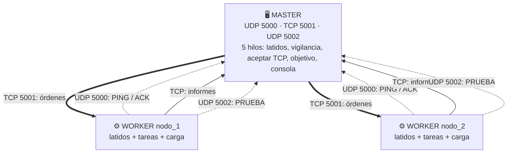

<div align="center">

# 🛰️ SocketGrid

### Sistema distribuido **Master–Worker** en Python
Latidos **UDP** · Control **TCP** · Concurrencia con **hilos** · Prueba de carga **sincronizada**


**Autores:** [Josue S. Vele](https://github.com/JosueVele77) · Juan D. Figueroa

</div>

---

## 📌 ¿Qué es SocketGrid?

SocketGrid es un sistema **cliente–servidor distribuido** donde un **Master** (coordinador) vigila a varios **Workers** (nodos trabajadores), les envía órdenes y coordina una prueba de carga. Usa **solo la biblioteca estándar de Python**: no hay nada que instalar.

| Canal | Protocolo | Puerto | Para qué |
|---|---|---|---|
| Latidos | UDP | `5000` | `PING` / `ACK`: saber quién está vivo |
| Control | TCP | `5001` | Registro, órdenes e informes (fiable) |
| Objetivo de carga | UDP | `5002` | `PRUEBA` → `RECIBIDO` |

## ✨ Características

- 🤝 **Registro en dos fases:** primero UDP (con ACK) y luego TCP. Un nodo desconocido no obtiene sesión.
- 💓 **Detección de fallos:** latido cada 2 s; sin latidos durante 6 s el nodo pasa a `CAIDO`.
- 🔒 **Exclusión mutua por Worker:** una sola tarea pesada a la vez (`ACTIVO` / `OCUPADO`).
- 🧵 **Concurrencia:** un hilo por sesión TCP, hilos de servicio en el Master y un hilo por tarea en el Worker.
- 📡 **Tareas remotas:** `EXEC_TASK:scan_ports`, `FETCH_LOGS` y `BROADCAST_STRESS`.
- ⏱️ **Carga sincronizada:** todos los Workers arrancan en la misma hora `t0` (ahora + 2 s).
- 🛡️ **Validaciones de seguridad:** la carga solo puede apuntar a la IP del Master y dura de 1 a 10 s; el identificador del Worker se valida.
- 🧹 **Apagado ordenado:** bandera `detener`, *timeouts* y bloques `finally`.

## 🏗️ Arquitectura



## 🚀 Inicio rápido

**Requisitos:** Python 3 (sin dependencias externas).

```bash
# 1) Clona el repositorio
git clone https://github.com/JosueVele77/SocketGrid-Master.git
cd SocketGrid-Master

# 2) Terminal 1 – Master
python master.py

# 3) Terminal 2 y 3 – Workers (cada uno con un identificador distinto)
python worker.py nodo_1
python worker.py nodo_2
```

> Para usar varias computadoras, inicia el Master con su IP real (`python master.py 192.168.1.10`) y los Workers con esa misma IP (`python worker.py nodo_1 192.168.1.10`).

## 🎮 Comandos del Master

| Comando | Descripción |
|---|---|
| `nodos` | Lista cada Worker con su CPU, estado y si tiene sesión TCP |
| `enviar <nodo> EXEC_TASK:scan_ports` | Escanea los puertos 5001–5003 del Master |
| `enviar <nodo> FETCH_LOGS` | Devuelve los últimos 10 resultados del Worker |
| `BROADCAST_STRESS:<ip>:<segundos>` | Prueba de carga en todos los Workers activos (1–10 s, la IP debe ser la del Master) |
| `salir` | Cierra el Master de forma ordenada |

## 📡 Protocolo

| Mensaje | Sentido | Significado |
|---|---|---|
| `PING:id\|cpu\|estado` | Worker → Master (UDP) | Latido |
| `ACK:id` | Master → Worker (UDP) | Confirma el latido |
| `REGISTRO:id` / `REGISTRADO:id` | Worker ↔ Master (TCP) | Apertura de sesión |
| `EXEC_TASK:scan_ports` | Master → Worker (TCP) | Escaneo de puertos |
| `FETCH_LOGS` | Master → Worker (TCP) | Consulta del historial |
| `BROADCAST_STRESS:ip:s\|t0` | Master → Worker (TCP) | Carga durante `s` s desde `t0` |
| `RESULTADO:id\|...` | Worker → Master (TCP) | Informe de la tarea |
| `PRUEBA` / `RECIBIDO` | Worker ↔ Master (UDP 5002) | Petición y respuesta de carga |

Cada mensaje TCP termina en `\n`, porque TCP es un flujo de bytes y no respeta límites de mensaje.

## 🧪 Evidencia de ejecución

Prueba realizada en una sola máquina (`127.0.0.1`) con un Master y dos Workers.

### 🖥️ Master


El Master registró a `nodo_1` y `nodo_2` por UDP y TCP, `nodos` los mostró `ACTIVO` con TCP `True`, y envió `scan_ports`, `FETCH_LOGS` y `BROADCAST_STRESS` a 2 Workers.

### ⚙️ Worker `nodo_1`


### ⚙️ Worker `nodo_2`


### 🔎 Qué demuestran los registros

| Observación | Explicación |
|---|---|
| `abiertos=5001` | Solo se detecta el puerto **TCP** 5001: el 5002 es UDP (el escaneo usa `connect_ex`, que es TCP) y el 5003 no tiene servicio. |
| `FETCH_LOGS\|OK\|` con detalle vacío | Aún no había resultados guardados; las consultas no se almacenan para no repetirse. |
| `ERROR\|Worker ocupado` | La orden `BROADCAST_STRESS` llegó mientras `scan_ports` seguía ejecutándose; la **exclusión mutua** la rechazó. |

> ⚠️ En esta ejecución la prueba de carga fue rechazada por Worker ocupado, así que **no hay métricas** de peticiones por segundo ni de latencia. Para obtenerlas, lanza `BROADCAST_STRESS` cuando los Workers estén libres, por ejemplo `BROADCAST_STRESS:127.0.0.1:3` después de que aparezcan los informes del escaneo.

## 📚 Bibliotecas utilizadas

| Módulo | Uso |
|---|---|
| `socket` | Canales UDP y TCP |
| `threading` | Hilos, `Lock` y `Event` |
| `time` | `monotonic`, `time`, `process_time` |
| `sys` | Argumentos de línea de comandos |
| `os` | `cpu_count` para el porcentaje de CPU |

## ⚠️ Limitaciones

- UDP no garantiza entrega: un latido perdido puede retrasar el estado.
- Sin autenticación ni cifrado.
- El Worker no se reconecta automáticamente.
- `scan_ports` solo cubre TCP.
- Las pruebas se hicieron en `loopback`, sin latencia ni pérdidas de una red real.

## 🗺️ Mejoras futuras

- [ ] Reconexión automática del Worker
- [ ] Autenticación con clave compartida y TLS
- [ ] Mensajes en JSON
- [ ] Configuración por argumentos en lugar de constantes
- [ ] Repetir la prueba de carga y registrar métricas

## 📄 Documentación

- 📘 **Artículo en formato IEEE:** [`docs/SocketGrid_IEEE.pdf`](docs/SocketGrid_IEEE.pdf)

## 👥 Autores

| | |
|---|---|
| **Josue S. Vele** | [@JosueVele77](https://github.com/JosueVele77) |
| **Juan D. Figueroa** | |

<div align="center">

Hecho con 🐍 y mucho `socket` · Octubre de 2026

</div>
